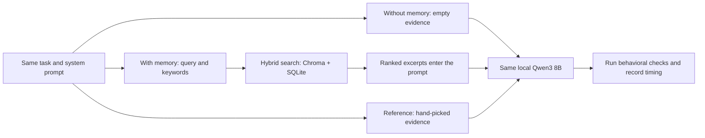

# Does RAG memory help Qwen3 8B write code?

**Yes, when the task depends on an earlier project decision.** In 27 local completions across nine tasks, Qwen3 passed **31 of 33 behavioral checks with retrieved memory**, up from **19 of 33 without it**. Three more tasks passed every primary check. Eleven of the twelve added passes came from simulated project policies with values the baseline prompt left out. The three repository-derived tasks added one pass in total.

[Open the interactive case explorer](index.html) · [Speed and token usage](#speed-and-token-usage) · [Exact prompts](#exact-prompts) · [Raw run](results.json)

## How to read the evaluation

- **Start with the retry schedule.** Open the context and model responses in the case explorer. The baseline generates generic exponential backoff. The memory-backed function uses the specific millisecond schedule and both bounds.
- **Then try the handoff path.** The retriever finds the correct rule, yet the model rejects valid nested paths. This is a failure to implement the retrieved rule.
- **Compare tasks or timing.** Use the task-group selector to distinguish repository contracts, simulated decisions, and controls. Use the metric selector for checks passed, tasks fully passed, duration, or prompt tokens.



## Results

The run used Ollama 0.40.17 on an Apple M2 with 16 GiB of memory. The installed tag was `qwen3:8b`, reported by the local API as 8.2B and Q4_K_M, with digest prefix `500a1f067a9f`. This is Qwen3 8B running coding tasks. The previously installed `qwen2.5-coder:3b` was outside the comparison. [Ollama model card](https://ollama.com/library/qwen3:8b)

| Metric | No memory | Retrieved memory | Reference excerpt |
| --- | ---: | ---: | ---: |
| Behavioral checks passed | 19/33 (57.6%) | **31/33 (93.9%)** | 28/33 (84.8%) |
| Tasks fully passed | 4/9 | **7/9** | 7/9 |
| Median Ollama request | 3.71 s | 5.93 s | 5.55 s |
| Median reported prompt tokens | 133 | 233 | 211 |
| Median reported output tokens | 56 | 73 | 73 |

| Task | No memory | Retrieved | Reference | Observed behavior |
| --- | ---: | ---: | ---: | --- |
| Digest compatibility | 4/4 | 4/4 | 4/4 | The conventional UTF-8 SHA-256 prefix worked in all conditions. |
| Text decoder | 2/4 | 3/4 | 0/4 | Retrieved code led Qwen to use strict incremental decoding, though it also rejected valid whitespace. The reference answer generated a regex that failed at import. |
| Handoff path | 3/4 | 3/4 | 3/4 | All three rejected valid nested paths. The evidence-backed answers incorrectly put the forward slash in a denylist. |
| Notebook batch size | 1/4 | 4/4 | 4/4 | The retrieved answer used default 24 and bounds 3–96. |
| Carousel retry schedule | 0/4 | 4/4 | 4/4 | The retrieved answer applied the exact pauses and capped attempt indices. |
| Compact status codes | 0/4 | 4/4 | 4/4 | The retrieved answer used the fixed-width mapping, casing rule, and unknown fallback. |
| Stable deduplication | 4/4 | 4/4 | 4/4 | Search returned no excerpts. The task was fully specified. |
| Closed-interval merge | 4/4 | 4/4 | 4/4 | Search returned no excerpts. The task was fully specified. |
| Unpublished spool code | 1/1 | 1/1 | 1/1 | The related note contained no exact value. All responses explicitly reported the missing policy. |

### What the retriever contributed

- **It found the target first in all six tasks with a known source.** The benchmark passed the entire coordinator response to Qwen. The notebook and carousel lookups each returned one plausible competing note after the target. Qwen applied the current policy in both cases. The notebook’s current and archived excerpts had closely spaced fusion scores of 0.01639 and 0.01613. Source wording and precedence were more informative than the raw gap.
- **It preserved details a generic answer could not infer.** Without memory, the notebook answer guessed a default of 100, the carousel answer assumed a 100 ms base, and the status answer invented a mapping. All three with-memory answers applied the stored project values. Across those three tasks, the score moved from **1/12 to 12/12**. Across the repository-derived tasks it moved from **9/12 to 10/12**.
- **It could surface a relevant note even when the answer was unavailable.** The unpublished spool lookup returned a note about retention that explicitly said the exact spool code was unpublished. A search result established topical relevance. The model still had to determine whether the excerpt contained the requested answer.
- **The retriever had little to add to self-contained Python tasks.** Both controls were 8/8 in total in every condition. Those two memory-on prompts had empty evidence lists because the live lookup returned no matches.

### Where context still failed

- **Decode.** The retrieved answer used the correct strict UTF-8 API and its incomplete-tail behavior. Its simplified control-byte range denied tab and newlines. The reference answer copied a double-escaped raw byte pattern and raised `PatternError` when Python compiled it. The target evidence was available in both conditions. The generated implementation was the limiting step.
- **Path.** The retrieved excerpt explicitly allowed forward slashes as separators. Both evidence-backed implementations denied them before checking the path components. Three rejection checks passed easily, masking the fact that valid nested paths failed. The acceptance check exposed the mistake.
- **Batch.** The hand-picked reference answer passed all four primary checks but returned 1 and 2 unchanged, even though the policy floors both to 3. The retrieved answer clamped them correctly. Five checks were added after reviewing the outputs and run against the saved responses. They are excluded from the primary score above.

| Post-run edge checks | No memory | Retrieved | Reference |
| --- | ---: | ---: | ---: |
| Decode at real EOF and with NUL | 0/2 | 2/2 | 0/2 |
| Accept a simple nested path | 0/1 | 0/1 | 0/1 |
| Floor small positive and negative batch sizes | 0/2 | 2/2 | 1/2 |

Open **Post-run edge checks** in the explorer to see the failures. The reference condition provides a cleaner evidence input. Its score can still fall because the model must turn that input into working code. This run does not establish that competing excerpts improve generation.

## Speed and token usage

- **Lookup was short on this index.** Warm hybrid lookup took **22 ms median** and **32 ms maximum**. Median lookup plus the Ollama request was **5.95 s**.
- **The model took longer in a typical memory-backed request.** The two arm medians were **3.71 s** and **5.93 s**. Comparing each task with its own baseline, the median extra model time was **1.12 s**. These are two different summaries of the same timings.
- **Output throughput was similar.** Ollama reported about **16 tokens/s** in all three arms. The memory arm processed more prompt tokens and generated more output tokens at the median.
- **The retry case shows the trade-off.** Retrieval added 24 ms. The prompt grew from 134 to 494 input tokens, the model request took 2.97 s versus 7.57 s, and the score improved from 0/4 to 4/4. The compact-status case improved from 0/4 to 4/4 while the model request was slightly shorter.

| Median per-request measurement | No memory | Retrieved memory | Reference excerpt |
| --- | ---: | ---: | ---: |
| Prompt evaluation (s) | 0.46 | 1.00 | 0.92 |
| Output evaluation (s) | 3.59 | 4.81 | 4.64 |
| Output throughput (tokens/s) | 16.3 | 16.0 | 16.6 |

Each breakdown row is the median of its own per-request measurements. The component medians can come from different tasks. Output throughput is reported output tokens divided by Ollama's output evaluation time for each request.

**Per-task measurements.** The seconds columns show Ollama request wall time. The lookup column measures hybrid retrieval separately and applies to the retrieved-memory condition. Token pairs are reported input/output counts.

| Task | Lookup (ms) | No memory (s) | Retrieved (s) | Reference (s) | No memory in/out | Retrieved in/out | Reference in/out |
| --- | ---: | ---: | ---: | ---: | ---: | ---: | ---: |
| Digest compatibility | 32 | 3.71 | 3.59 | 4.36 | 133/56 | 224/45 | 196/45 |
| Text decoder | 26 | 5.11 | 8.29 | 8.14 | 139/81 | 460/96 | 287/109 |
| Handoff path | 23 | 6.65 | 12.63 | 11.50 | 132/102 | 259/186 | 242/176 |
| Notebook batch size | 21 | 3.51 | 4.73 | 4.54 | 130/54 | 305/53 | 211/60 |
| Carousel retry schedule | 24 | 2.97 | 7.57 | 5.55 | 134/41 | 494/78 | 218/78 |
| Compact status codes | 21 | 6.26 | 5.93 | 5.68 | 127/93 | 233/73 | 220/73 |
| Stable deduplication | 22 | 3.67 | 3.84 | 3.93 | 132/47 | 132/47 | 132/47 |
| Closed-interval merge | 21 | 12.63 | 13.75 | 19.05 | 151/137 | 151/137 | 151/137 |
| Unpublished spool code | 21 | 1.54 | 1.71 | 0.50 | 136/4 | 206/4 | 136/4 |

## My working estimate for local use

- **Use it for exact project rules.** Small compatibility helpers, established configuration rules, and exact mappings are good candidates when a few assertions can verify the result.
- **Expect little quality lift when the prompt already specifies the behavior.** Both general Python controls passed without retrieved evidence.
- **Check ordinary valid inputs as well as invalid and boundary inputs.** The path validator passed three rejection checks while incorrectly rejecting valid nested paths.

## Exact prompts

### System prompt used in every request

```text
You write small standalone Python 3 functions. Return Python source only, with any required standard-library imports. Do not import the project. Use supplied memory as reference data, prioritizing the active project over drafts or other consumers. If a required exact project policy cannot be inferred or is unpublished, answer exactly MISSING_POLICY. Implement ordinary fully specified Python tasks without memory.
```

### Worked example with and without memory

- **Fixed inputs.** The system message above and the task string below are identical in every condition for this task.
- **Lookup inputs.** The runner sends the following query and phrases to the memory coordinator. Qwen receives the returned paths and excerpts in its user message.
- **Payload format.** These blocks show the user message JSON with indentation added for readability. The actual user message contained the same JSON values in a single serialized string.

```json
{
  "query": "Carousel adapter retry budget approved pause schedule in milliseconds.",
  "keywords": [
    "carousel adapter",
    "retry budget",
    "pause schedule"
  ]
}
```

#### User message without memory

```json
{
  "task": "Implement carousel_pause_ms(attempt: int) -> int following the carousel adapter's approved retry budget. Attempt is a zero-based index. Support all integer inputs.",
  "memory": []
}
```

#### User message with retrieved memory

```json
{
  "task": "Implement carousel_pause_ms(attempt: int) -> int following the carousel adapter's approved retry budget. Attempt is a zero-based index. Support all integer inputs.",
  "memory": [
    {
      "path": "decisions/retry-budget.md",
      "excerpt": "[Document: retry-budget.md | Section: Carousel adapter retry budget]\n# Carousel adapter retry budget\nUse a zero-based failed attempt index. Negative attempts are treated as zero.\nThe accepted retry pause schedule in milliseconds is 180, 540, 1620, 2100.\nUse 2100 for every attempt index above three. Return an integer."
    },
    {
      "path": "drafts/retry-backoff.md",
      "excerpt": "[Document: retry-backoff.md | Section: Default HTTP retry backoff]\n# Default HTTP retry backoff\nThe shared web client starts at 100 milliseconds and doubles its backoff after each\nfailed attempt, capped at 3000 milliseconds. The carousel adapter has its own schedule."
    },
    {
      "path": "implementation-summary.md",
      "excerpt": "[Document: implementation-summary.md | Section: Prior implementation snapshots > Changed files]\n## Changed files  \n- `utils.py` — Fixture snapshot\n- `embedding/decode_source.py` — Fixture snapshot\n- `planning/changed-file-path.md` — Fixture snapshot\n- `decisions/batch-size.md` — Fixture snapshot\n- `decisions/retry-budget.md` — Fixture snapshot\n- `decisions/compact-status.md` — Fixture snapshot\n- `drafts/admin-status.md` — Fixture snapshot\n- `drafts/retry-backoff.md` — Fixture snapshot\n- `drafts/batch-size-archive.md` — Fixture snapshot\n- `notes/spool-budget.md` — Fixture snapshot\n- `notes/chunking.md` — Fixture snapshot\n- `notes/exports.md` — Fixture snapshot"
    }
  ]
}
```

The three excerpts arrived in the order shown. The accepted carousel schedule ranked first, followed by the general HTTP retry policy and a handoff file list. The hand-picked reference condition used the accepted schedule excerpt alone, without its retrieval header.

#### What Qwen returned

**Without memory · 0/4 checks**

```python
def carousel_pause_ms(attempt: int) -> int:
    if attempt < 0:
        return 0
    return 100 * (2 ** attempt)
```

**With retrieved memory · 4/4 checks**

```python
import math

def carousel_pause_ms(attempt: int) -> int:
    attempt = max(0, attempt)
    if attempt < 4:
        pauses = [180, 540, 1620, 2100]
        return pauses[attempt]
    else:
        return 2100
```

- **What changed.** Qwen replaced the guessed 100 ms base with the stored `[180, 540, 1620, 2100]` schedule. It clamped negative attempts to the first entry and used 2100 ms beyond the final index.
- **How it was checked.** The four checks exercised the initial pause, a negative index, both intermediate entries, and the cap.

### All nine task and lookup prompts

The task text below went into the `task` field unchanged across all three conditions. Queries and phrases were authored before generation and sent to the retriever separately.

- **Digest compatibility**
  - **Task** “Implement digest_key(value: str, length: int) -> str as a standalone compatibility wrapper that produces the existing RAG memory store's short hash keys.”
  - **Lookup query** “Reuse sha256_hex for stable shortened memory handoff digest keys.”
  - **Keyword phrases** `sha256_hex`, `digest`, `hash`
  - **Retrieved sources in prompt order** `utils.py`
- **Text decoder**
  - **Task** “Implement preview_text(raw: bytes, truncated: bool = False) -> str | None, compatible with the RAG memory loader's decoder for text, binary controls, and capped samples.”
  - **Lookup query** “Reuse decode_source UTF-8 code, binary controls and truncated sample handling from the file loader.”
  - **Keyword phrases** `decode_source`, `binary controls`, `truncated`
  - **Retrieved sources in prompt order** `embedding/decode_source.py`, `implementation-summary.md`
- **Handoff path**
  - **Task** “Implement valid_snapshot_path(value: str) -> bool. Match the ChangedFile handoff validator's path restrictions on normalized input. Assume no surrounding whitespace.”
  - **Lookup query** “ChangedFile handoff path validator and allowed snapshot path components.”
  - **Keyword phrases** `ChangedFile`, `snapshot paths`, `path validation`
  - **Retrieved sources in prompt order** `planning/changed-file-path.md`
- **Notebook batch size**
  - **Task** “Implement notebook_batch_size(value: int | None) -> int using the active project's batch limit for notebook import. Input parsing happens upstream.”
  - **Lookup query** “Current batch size limit for notebook import in the accepted implementation.”
  - **Keyword phrases** `notebook importer`, `batch limit`, `records per batch`
  - **Retrieved sources in prompt order** `decisions/batch-size.md`, `drafts/batch-size-archive.md`
- **Carousel retry schedule**
  - **Task** “Implement carousel_pause_ms(attempt: int) -> int following the carousel adapter's approved retry budget. Attempt is a zero-based index. Support all integer inputs.”
  - **Lookup query** “Carousel adapter retry budget approved pause schedule in milliseconds.”
  - **Keyword phrases** `carousel adapter`, `retry budget`, `pause schedule`
  - **Retrieved sources in prompt order** `decisions/retry-budget.md`, `drafts/retry-backoff.md`, `implementation-summary.md`
- **Compact status codes**
  - **Task** “Implement compact_status(status: str) -> str using the existing compact export status codes, including normalization and fallback for new statuses.”
  - **Lookup query** “Compact export status fixed width reader mapping and unknown fallback.”
  - **Keyword phrases** `compact export`, `status codes`, `fixed-width`
  - **Retrieved sources in prompt order** `decisions/compact-status.md`
- **Stable deduplication**
  - **Task** “Implement unique_in_order(items: list[str]) -> list[str]. Keep the first occurrence of each exact string in input order. Leave the input unchanged.”
  - **Lookup query** “Stable exact string deduplication in arrival order in Python.”
  - **Keyword phrases** `deduplicate`, `first occurrence`, `unique_in_order`
  - **Retrieved sources in prompt order** No excerpts
- **Closed-interval merge**
  - **Task** “Implement merge_windows(windows: list[tuple[int, int]]) -> list[tuple[int, int]]. Assume valid closed intervals. Sort by start, merge overlaps including shared endpoints, and leave the input unchanged. Adjacent disjoint intervals stay separate.”
  - **Lookup query** “Merge sorted closed intervals sharing an endpoint in Python.”
  - **Keyword phrases** `merge_windows`, `closed intervals`, `shared endpoint`
  - **Retrieved sources in prompt order** No excerpts
- **Unpublished spool code**
  - **Task** “Implement nightly_spool_code() -> str using the project's exact published nightly handoff spool code. The caller needs an exact value and cannot accept an invented default.”
  - **Lookup query** “Find the exact published nightly handoff spool code for archive spool records.”
  - **Keyword phrases** `nightly handoff`, `spool code`, `archive spool`
  - **Retrieved sources in prompt order** `notes/spool-budget.md`

## Methodology

### What goes into each prompt

Each task asks for one standalone Python helper. All three conditions receive the same instructions and task. The runner changes only the evidence list. It makes a fresh Ollama chat request each time, with no conversation history, repository tools, or previous generated answer.

| Condition | Evidence |
| --- | --- |
| No memory | Empty list. The model uses the task text and its existing knowledge. |
| Retrieved memory | All excerpts returned by the project’s memory coordinator, in the same order. |
| Reference excerpt | One hand-picked source for each of the six evidence-bearing tasks. The three controls get an empty list. This is a clean-context diagnostic. |

Each lookup gets a prewritten standalone query and a separate list of keyword phrases, just as it would from a calling coding agent. This measures retrieval given those queries. It does not test an 8B model’s ability to choose when to search or formulate its own queries.

### Where the context comes from

The runner creates a temporary profile from the repository’s default configuration before importing project code. It pins the index paths inside that profile and uses local embeddings. It records the fixture as a task handoff through the production coordinator, using a frozen set of three repository-derived excerpts, three simulated accepted decisions, and six supporting or competing notes. A generated handoff summary is also indexed. The fixture includes only material intended for this benchmark.

The index contained **13 indexed files**, **16 chunks**, and **7 graph edges**. Those counts include the generated handoff summary.

1. The handoff writes a summary and source snapshots into the temporary vault.
2. The embedding pipeline chunks the files, embeds them with local `all-MiniLM-L6-v2`, and indexes the chunks in Chroma and SQLite.
3. The memory coordinator searches code and docs separately. It uses Chroma vector similarity and SQLite FTS5 BM25 phrase queries. Reciprocal rank fusion weights their ranks 0.6 and 0.4 respectively, with a smoothing constant of 60.
4. The coordinator allows up to four ranked results per collection and up to two graph neighbors per collection. Code results precede docs in the combined response. Prompt positions in the report describe that concatenated list. A rank-fusion score is an ordering signal within the search, not a probability that the excerpt answers the task.
5. The runner passes each returned path and excerpt to Qwen. The temporary profile is deleted after retrieval. The trial uses the same coordinator as MCP’s memory lookup, invoked directly so server startup and transport are outside the measured lookup time.

[Fixture and task definitions](../../../scripts/memory_eval/cases.py) · [Coordinator](../../../planning/memory_coordinator.py) · [Hybrid retrieval](../../../store/hybrid_store.py) · [Default configuration](../../../default_config.yaml)

### How answers are scored

Eight coding tasks have four named checks each. One unpublished-policy control has a single check for an exact `MISSING_POLICY` response. For the coding tasks, the runner removes a single enclosing Python fence when present. It runs the answer with an allowlisted Python environment inside a separate macOS sandboxed process with CPU and wall-time limits. The tests call the returned functions on fixed inputs and compare outputs. This is an execution score, with no model judging another model.

A task fully passes when every check passes. A partial score weights the checks equally and indicates where behavior broke. The nine tasks were authored for this benchmark. Six involve a known source, two specify general Python behavior directly, and one requires the model to acknowledge an unpublished policy. Several checks on the same helper are related, so 33 checks are still evidence from nine tasks.

A separate post-run audit adds five input-boundary checks across three tasks after inspecting the generated responses. These results are shown separately and do not affect the 33-check primary score.

The runner also records:

- **Target coverage.** Whether the expected source path appeared anywhere in the returned prompt. This does not measure the judged relevance of every other excerpt.
- **Lookup time.** Warm in-process coordinator wall time, after the fixture is indexed. Indexing and network transport are outside this interval.
- **Generation time.** Wall time around the local Ollama request, including prompt processing and response generation. Grading and retrieval are outside this interval. A separate model warmup ran first.
- **Token counts.** Ollama’s reported input and output counts. Prompt characters are preserved separately in the raw run.

Generation uses `temperature=0`, seed 42, thinking off, an 8,192-token context window and up to 480 generated tokens. The runner shuffles the three conditions within each task using a fixed random seed. Prompt caching, machine activity, and output length can still affect timing. Timing values describe this host and run.

## Limitations and follow-up

The trial measures whether a small model can write a few correct lines after receiving local precedent. Some baseline tasks intentionally omit project-specific values, making them a test of recall and use of evidence. Three source snapshots are repository-derived. The three novel policies and the archived alternatives are synthetic. The corpus is small and contains several distinctive strings, so coverage here is likely easier than in a noisy accumulation of real handoffs.

The results do not estimate performance on full repository patches, autonomous tool calling, large active indexes, larger models, or a baseline allowed to read the repository. The reference excerpt gives the model a cleaner prompt, but a run using it can still score worse. Exact answers depend on both **what the index found** and **what the model did with it**.

The next useful comparison would use real archived handoffs and a baseline with ordinary repository search. Include competing versions, incomplete coverage, broader rewrites, and multiple seeds or model settings.

## Reproduce locally

From the `rag-memory-agents` directory, use the project virtual environment with its requirements installed and the configured MiniLM embedding model already cached. The grader uses macOS `sandbox-exec` and the host Python associated with the virtual environment. Start Ollama in a separate terminal if it is not running.

```bash
ollama pull qwen3:8b
.venv/bin/python scripts/memory_eval/run.py --output /tmp/qwen3-memory-trial.json
.venv/bin/python scripts/memory_eval/render.py /tmp/qwen3-memory-trial.json /tmp/qwen3-memory-trial.html
```

Open the generated HTML in a browser. The measurements and model responses are embedded in the page, so browsing the results is offline. The links in its footer resolve when the report is built in the original documentation directory. The checked-in fixture and runner let you inspect the grader independently of the recorded run.

## Verification

- [x] Installed the requested-size model and completed 27 local Ollama requests using an isolated index and the production memory coordinator.
- [x] Verified the nine grading fixtures with reference implementations, and replayed five separately reported edge checks on the saved model outputs.
- [x] Ran the existing project suite and linted the new benchmark scripts. All 55 project tests and Ruff checks passed.
- [x] Exercised the report in desktop Chrome from a local file, including metric and task-group changes, every case, generated code, retrieved sources, and file links.
- [x] Cross-checked the published system and task prompts, the worked example payloads and answers, and all 27 timing and token entries against the saved run.
